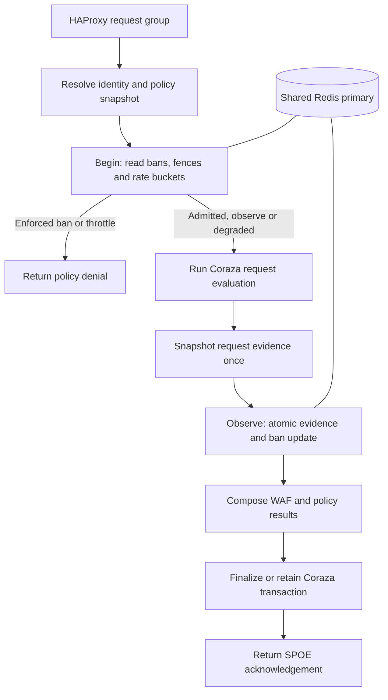

# Cluster-wide scanner auto-ban for Coraza SPOA

Status: implementation specification. This document describes a proposed feature, not behavior available in the current binary.

Date: 2026-11-20, Asia/Ho_Chi_Minh.

Repository: `ba0f3/coraza-spoa`.

Source baseline: [`c9b34f409e04cfb60219602bd1ad711afd15eaa3`](https://github.com/ba0f3/coraza-spoa/tree/c9b34f409e04cfb60219602bd1ad711afd15eaa3).

Implementation checklist: [cluster auto-ban plan](../plans/2026-11-20-cluster-autoban.md).

## 1. Outcome and scope

HAProxy deployments that share a Coraza SPOA cluster must share scanner counters and temporary bans. A request contributes structured evidence directly during request inspection. An effective ban is enforced by HAProxy on a later request, regardless of which HAProxy or SPOA instance receives that request. Operators can explain a ban and remove it without collecting logs from individual proxies.

Implement the policy in a separate Go package inside this repository. Coraza remains the rule engine, Redis holds shared policy state, and HAProxy enforces the returned decision. Logs are an audit output, not an input required for enforcement.

### Required in v1

- Per-application IP bans, with explicit global match policies for high-confidence signals.
- Pattern detection through custom Coraza rules and selection of existing rules by ID or tag.
- One bounded contribution per request and matching policy, including early WAF interruptions.
- Exact rolling windows for repeated attack evidence.
- Shared token buckets for configured endpoint groups, returning HTTP 429.
- Separate `observe` and `enforce` modes.
- Redis-backed expiry, inspection, bounded listing, and administrative unban/reset.
- Explicit degraded behavior, bounded dependency work, metrics, and multi-node tests.
- Compatibility with existing configuration when the feature is absent or disabled.

### Deferred

Response-derived evidence such as 404 enumeration, automatic punishment escalation, external reputation feeds, challenges/CAPTCHA, user-account bans, HAProxy map distribution, an early lightweight SPOE precheck, local policy-state caches, and an admin UI are deferred. Native Redis Cluster is not a supported v1 deployment. Standalone Redis and Sentinel with one authoritative primary are supported.

The feature protects HTTP transactions that reach this integration. Connection admission and volumetric protection remain HAProxy or network responsibilities.

### Alternatives considered

| Approach | Assessment |
| --- | --- |
| Aggregate logs and distribute bans to each HAProxy | Adds event delay and distribution work that motivated this feature. |
| HAProxy stick-tables with peers alone | Useful for local limits; peer updates overwrite remote counter values without aggregation. They do not implement the required shared atomic thresholds. |
| Policy package in SPOA with shared Redis | Selected. It consumes structured evidence inline and reuses the existing HAProxy enforcement path. |
| Separate policy HTTP service | Adds another protocol and deployment. Keep a package boundary so extraction remains possible if other consumers appear. |

## 2. Verified baseline and integration boundaries

The baseline module is `github.com/corazawaf/coraza-spoa`, with Go `1.25.7`, Coraza `v3.8.1`, CRS `v4.25.0`, and `haproxy-go v0.1.1`. Keep the module path and Go version. Add a Redis client within this module; do not create a nested module or change Coraza core to implement this feature.

| Existing location | Relevant behavior |
| --- | --- |
| `config.go`: `readConfig`, `newApplications` | YAML uses `KnownFields(true)`. New fields need typed schema and validation. |
| `config.go`: `reloadConfig` | Builds replacement applications and swaps them. It does not provide resource retirement or cross-reload response correlation. |
| `main.go`: `main` | `-validate` parses configuration and compiles WAF applications before opening listeners. Runtime dependency initialization must remain separate. |
| `internal/agent.go`: `HandleSPOE` | Consumes `app` as the first KV entry, resolves an application/default, then dispatches `coraza-req` or `coraza-res`. |
| `internal/application.go`: `HandleRequest` | Parses `src-ip`, creates a transaction, processes request phases, and has multiple early returns. |
| `internal/agent.go`: interruption handling | Exports WAF `action`, `status`, `data`, and `ruleid`. Other generic handler errors fail the SPOE stream. |
| `internal/application.go`: `exportWAFMetrics` | Filters some rule IDs and rules without messages. Those telemetry filters must not define policy evidence. |
| `internal/metrics.go`: `recordTransactionMetrics` | Runs at transaction completion, which can occur after response inspection or expiry. It is too late for request admission decisions. |
| `internal/ttlcache.go` | Holds live request-response transaction correlations inside one process. Preserve this cache. |

Coraza v3 does not provide usable persistent IP collections for this design. Implement state in the wrapper rather than assuming that `initcol` and `expirevar` make counters persistent.

## 3. Invariants

The implementation and tests must preserve these invariants:

1. An absent or disabled `autoban` configuration adds no Redis dependency or policy enforcement.
2. A resolved configured application name and a canonical trusted client IP define the subject.
3. Every eligible policy request has one `Begin` and at most one aggregated `Observe` call. Disabled, exempt, or invalid-identity requests bypass store admission.
4. Evidence is captured before response caching, transaction close, or reuse of borrowed buffers.
5. A request that receives a successful threshold-creating result is denied before its request SPOE acknowledgement permits origin forwarding.
6. Requests admitted before another request commits a ban may finish. There is no promise to cancel requests already admitted.
7. `observe` never writes enforcement state or creates an effective policy denial. Ordinary WAF enforcement remains unchanged.
8. A ban lookup or request rejected by an existing ban does not refresh the ban or add strikes.
9. Unban clears previous counters and fences earlier in-flight evidence.
10. Store failure cannot masquerade as a clean policy result or as a WAF/SPOE error.
11. Any Coraza transaction that was created is closed or transferred to the existing correlation owner exactly once.
12. No policy-state cache is used in v1. Existing Coraza response-correlation storage is not a policy-state cache.

## 4. Identity, scope, and evidence

### 4.1 Trusted identity

Use `app.Name` after `Agent.HandleSPOE` resolves the incoming application. A configured default application remains the canonical name when fallback occurs. Do not use arbitrary incoming `Host` or `app` text as Redis namespaces or metric labels.

HAProxy supplies the effective client address in the existing `src-ip` argument. Establish forwarding-header and PROXY-protocol trust at HAProxy. This feature does not implement a second forwarded-header resolver. Restrict access to the SPOA listener to authorized proxies.

Canonicalize addresses with `netip.Addr.Unmap()`. Support IPv4 and IPv6 as individual addresses. Do not automatically widen IPv6 bans to a prefix. An invalid or missing address disables the additional policy for that request with `degraded_reason=invalid_identity`; existing WAF processing still runs.

Generate a 128-bit cryptographically random policy request ID once at the request handler boundary. Keep it separate from the existing Coraza transaction ID. Do not use an incoming HTTP request-ID header or the existing `math/rand` fallback ID as a deduplication identity. Carry this policy request ID through the admission token, evidence, and decision log.

V1 performs no automatic Redis command replay and requires one request-group invocation per HTTP request. It guarantees contribution deduplication within that invocation. It does not claim exactly-once counting across duplicated SPOE deliveries. A future trusted transport ID extension must define that contract before enabling cross-delivery retries.

### 4.2 Scope

- Application scope is the default for match and rate policies.
- Global match policies are declared once under top-level `autoban.global_policies`. They aggregate across applications that explicitly enable auto-ban in the same mode.
- Global policies accept only selected rule IDs/tags and must be explicitly enabled. Ordinary rate limits and generic 403/404 counts cannot create global bans in v1.
- An enabled application checks both its application ban and the global ban. A disabled application opts out of auto-ban, including global policies.
- Global and application records are independent. Removing an application ban does not remove a global ban; inspection reports both.

If both scopes have active bans, return the global record as the explanation and report both records to the admin API. The configured HAProxy response is still 403.

### 4.3 Match evidence

Capture immutable scalar metadata from `tx.MatchedRules()` after the request-phase evaluation stops. Retain rule ID, phase, tags, severity, and whether the WAF actually interrupted the request. A parsed inbound anomaly score is optional; missing or invalid is not equivalent to zero.

Only phases 1 and 2 contribute in v1. Do not count response matches, logging-phase matches, transaction expiry, the number of log lines, or the number of matched variables. Do not treat CRS blocking-summary rules as independent attack evidence.

For one policy, `rule_ids` and `rule_tags` are alternative selectors: any selected ID or any exact selected tag qualifies. Additional `min_anomaly_score`, if present, is an AND condition requiring a valid score. Deduplicate selected matches before producing one strike for that policy. A request can contribute once to each of several explicitly configured policies.

Use custom Coraza rules for path/payload patterns so the existing Coraza parsing and transformation semantics apply. Tag those rules with a policy-specific tag such as `autoban/secret-probe`. The policy must also see a qualifying custom rule outside the historical telemetry ID ranges and with `nolog` or an empty message. No match-message parsing is permitted.

If request inspection fails with a non-interruption WAF error, preserve that error and do not create additional bans from the incomplete evidence. A normal WAF interruption is a valid end of request evaluation and must still produce evidence.

### 4.4 Exemptions

Per-application `exempt_cidrs` bypass all additional auto-ban checks, counting, and throttling for those addresses, including global checks for that application. They do not bypass Coraza. The default list is empty. Do not implicitly exempt all private address space or any user-agent string.

An admin unban suppression window prevents new match-based strikes in the selected scope. It does not disable newly reset endpoint rate limits. A full temporary bypass uses an explicit exemption with its own configuration change.

## 5. Request flow and decision composition



### 5.1 Admission

Parse the request and resolve identity before creating a Coraza transaction. Capture one immutable compiled policy snapshot for the entire handler call.

`Begin` performs one bounded Redis script invocation for the relevant mode, global scope, application scope, and matched rate policies. It returns the Redis time, generation fences, the existing ban decision, and any rate decision.

In enforce mode, an existing ban returns 403 and a rate rejection returns 429 without creating a Coraza transaction. In observe mode, the same decisions are reported as `would_ban`/`would_throttle`, and WAF inspection continues. A shadow ban stops further shadow strike accumulation in that scope until expiry, matching the enforcement lifecycle. A shadow rate rejection produces no match evidence in any scope; inspection still runs only to preserve ordinary WAF behavior. If a shadow ban would have stopped the request before all rate/evidence work, skip that work for the whole request, including other scopes.

On a store failure, return a degraded result with an unusable admission token. Run WAF normally and skip all subsequent policy evidence writes for that request. Never synthesize an unvalidated token after a timeout.

### 5.2 Request evidence update

Refactor request evaluation so early phase-1, body-limit, and phase-2 interruptions pass through one request-finalization step. That step copies evidence while the transaction is still owned by the handler, then calls `Observe` if admission succeeded and a match policy qualifies.

`Observe` checks admission age and generation, prunes expired evidence, deduplicates the request ID, updates qualifying policies, and may create one ban per affected scope atomically. The threshold-creating request receives a policy ban verdict. Existing WAF enforcement can already have denied the same request.

If another request created a ban after this request was admitted, skip further strikes and expiry changes in that scope. This request keeps its original admission. A duplicate `Observe` for the stored triggering request ID returns its original ban decision without extending the ban.

No background evidence queue is used in v1. An `Observe` timeout is an uncertain outcome: the write may have succeeded. Keep the current WAF result, mark policy degradation, and do not retry. Subsequent requests can see the created ban. This is the explicit failure exception to the successful threshold-creating-request guarantee.

### 5.3 Verdict precedence

| Situation | Effective behavior |
| --- | --- |
| Auto-ban disabled or exempt | Existing WAF behavior only |
| Observe mode | Existing WAF behavior; expose a separate hypothetical policy result |
| Enforced existing ban | Policy 403 before WAF creation |
| Enforced rate rejection | Policy 429 before WAF creation |
| WAF processing error | Preserve the existing WAF/SPOE error path |
| WAF deny/drop/redirect plus new policy ban | Preserve the WAF action for the current request; persist and report the policy ban separately |
| WAF allows plus new policy ban | Policy 403 |
| Store unavailable | Existing WAF behavior; separate degraded metadata |

Auto-ban mode is explicit and independent from `SecRuleEngine DetectionOnly` and the existing request/response `detect-only` SPOE arguments. Do not silently change those existing semantics. Enabling `autoban.mode: enforce` is an independent enforcement choice; defaults and examples use observe.

### 5.4 Transaction lifecycle

An early policy denial creates no Coraza transaction and must not increment metrics whose documented meaning is WAF transactions created or completed. Add separate auto-ban request/decision metrics.

If a transaction exists and the composed request result is a local policy denial, process logging, record existing WAF metrics according to the actual WAF result, and close the transaction once. Do not cache it while returning a policy denial or count it as an expired response transaction.

If the request remains eligible for origin forwarding, preserve the existing response-check and detect-only ownership rules. Do not remove the in-process transaction cache. Do not use `HandleResponse`, asynchronous response evaluation, or TTL eviction to generate auto-ban evidence.

SPOE writer failures remain protocol failures. A dependency failure is a different condition and must never be returned as a generic handler error.

## 6. Redis state and algorithms

### 6.1 Supported deployment and bounds

Use Redis 7.2 or newer, standalone or Sentinel, with primary reads and writes. Do not use replica reads for policy decisions. Keep a shared connection pool per runtime, and use a dedicated key prefix unique to the intended environment/policy cluster. Redis replication is asynchronous; the feature does not promise that every acknowledged ban survives every failover.

Use `github.com/redis/go-redis/v9` as the client and pin its resolved version in `go.mod`/`go.sum` during implementation. Disable automatic retries of commands whose execution outcome is uncertain. On an explicit `NOSCRIPT` response, loading/evaluating the known script is permitted within the original deadline because the missing script was not executed. No Redis transaction is required to modify Coraza core.

Defaults and hard limits:

| Setting | Default | Validation |
| --- | --- | --- |
| Operation timeout | 20 ms | 1–100 ms |
| Total store budget per HTTP request | 50 ms | At least operation timeout; at most 200 ms |
| Concurrent store operations per process | 128 | Positive; no unbounded waiting queue |
| Admission maximum evidence age | 30 s | Fixed in v1 |
| Generation fence retention | 120 s | Fixed minimum; longer when required by suppression |
| Match window | Explicit per policy | 30 s–1 h |
| Match threshold | Explicit per policy | 1–256 requests |
| Ban duration | Explicit per policy | 30 s–24 h |
| Policies evaluated per request | At most 32 | Global plus application policies combined |
| Retained policy fields per subject | At most 64 | Expired fields pruned before adding fields |
| Matched rule metadata copied per request | At most 256 selected rule records | Overflow is degraded, not a partial-evidence ban |

The total store budget covers pool acquisition, scripts, and any permitted script loading. Subtract each operation's actual monotonic elapsed dependency time from the same remaining budget. WAF execution time does not consume this store-only budget, but every call also respects the original request context and the 30-second admission-age limit. Each operation deadline is the minimum of its configured timeout, remaining store budget, and parent deadline. The second call cannot reset the remaining budget. Reject excess local store work immediately as degraded rather than queueing indefinitely. Keep the default below the example's 500 ms SPOE processing timeout, and verify the total budget against the deployed timeout.

Use `maxmemory` with an explicit capacity plan and no silent eviction of active ban/fence state. The reference deployment uses `noeviction`. OOM/write rejection is degraded. If keys are manually deleted or an administrator flushes Redis, continuity guarantees no longer apply; record and alert on the incident.

### 6.2 Key layout

Encode canonical IP bytes as lowercase hex. Encode configured application IDs with an unambiguous length-prefixed or base64url representation. Only trusted identifiers enter keys.

```text
<prefix>:v1:<mode>:{<ip_hex>}:state:global
<prefix>:v1:<mode>:{<ip_hex>}:state:app:<app_id>
<prefix>:v1:<mode>:{<ip_hex>}:fence:global
<prefix>:v1:<mode>:{<ip_hex>}:fence:app:<app_id>
```

`mode` is `observe` or `enforce`. Hash tags keep all scopes for one IP colocated for a possible future Cluster implementation; they do not make Cluster supported in v1.

Each scope has one bounded Redis hash containing its current ban and bounded policy-state fields. Use a hash field per policy fingerprint for rolling evidence and token-bucket state. An unban deletes the entire selected scope hash, clearing all policy revisions together. Do not use generation-prefixed counter keys that can become reachable again when a fence expires.

Scripts receive every accessed key explicitly. Validate inputs, key types, encoded field size, stored values, arithmetic, and post-update capacity across both scopes before the first mutation. An encoded policy-state field is limited to 64 KiB and a subject hash to 4 MiB of encoded application data. For a mutation, reject `clock_regression` if any touched policy field's update/refill timestamp or strike timestamp is later than Redis now; an age-valid ticket alone is insufficient to detect this case. Lua execution is atomic with respect to other commands, but a runtime error does not roll back writes already performed. Classify a failure after mutation begins as an uncertain outcome; never report that it was canceled or rolled back.

A policy fingerprint is SHA-256 over canonical policy semantics, including its configured ID, policy type, scope, selectors, thresholds, window, action, and duration. Distinct policy IDs with otherwise identical semantics remain distinct fields. Global fingerprints exclude the originating application, so the same global policy aggregates across participating applications. Counter and bucket fields are isolated by fingerprint. Existing bans remain effective until their fixed expiry or administrative removal, even when a policy changes or is removed. Policy changes require coordinated rollout; this feature distributes state, not configuration. Export the active configuration revision for comparing nodes.

Every field carries an absolute logical expiry. Prune expired fields during writes. The key TTL is the maximum remaining expiry of its fields. A successful read never refreshes TTL. An active ban's `expires_at_ms` remains fixed even if another field causes the containing hash to live longer.

Clean admission without applicable rate policies performs reads only and creates no per-client state. A request already blocked by a ban creates no new state. Do not create a receipt key for every denied rate-limit request.

### 6.3 Rolling strike windows

Use Redis server time in milliseconds. Each qualifying policy field stores a bounded ordered list of `(observed_at_ms, request_id)` entries. The timestamp is the successful evidence-update time, not a client timestamp. Remove entries at or before `now - window`; the active interval is `(now - window, now]`.

One request ID appears at most once per policy. A threshold of `N` creates a ban on the `N`th distinct contribution, including `N=1`. A field never needs more than `N` entries before activation. The configured window and ban-duration minimums keep IDs or the triggering-ban receipt alive for the maximum accepted evidence lifetime.

When multiple policies cross in one scope, choose the longest configured duration; break ties by lexicographic policy ID. Record the winning policy and the bounded list of qualifying policy IDs. Set `created_at_ms` and `expires_at_ms` once. Clear all match-evidence fields for that scope when creating the ban, including other policy revisions, while retaining the triggering request ID in the ban. This starts fresh strike windows after expiry even when the original window is longer than the ban. Preserve rate fields with their existing logical expiries. Do not extend an existing ban from rejected traffic or late evidence. Escalation after expiry is deferred.

### 6.4 Token buckets

Rate policies are application-scoped and keyed by their configured policy ID/fingerprint plus client IP. A policy selects a finite endpoint group using an explicit method list and `path_exact` or `path_prefix` selectors. Empty selectors match all requests. Compare the raw path supplied by HAProxy without a second decoding algorithm; deployments must include aliases accepted by the origin and verify encoded-path cases. Arbitrary URI values never become rate-state keys.

Each policy defines `requests`, `period`, and `burst`. Refill rate is `requests / period`; bucket capacity is `burst`; a request costs one token. Start full. Refill with elapsed Redis time and cap at capacity. Never move the last-refill timestamp backwards; reject a stored future timestamp during preflight, rather than crediting the clock catch-up interval twice.

Evaluate all matching buckets atomically. If any lacks one token, consume none of the matching buckets and return throttle. Otherwise consume one from each. Calculate `Retry-After` as the ceiling of seconds until every rejecting bucket can supply one token, minimum 1. A rate rejection creates no IP ban and no match-evidence strike.

Expire idle buckets when they would be full again, with a minimum retention of 30 seconds. Require a positive integer `requests`, a period of 1 ms–1 h expressed as whole milliseconds, a refill rate of at most 10,000 requests per second, and burst of 1–10,000. Use integer-scaled token units based on period milliseconds; clamp elapsed refill to the time needed to become full before multiplying. Reject configurations whose arithmetic exceeds exact integer representation in Redis Lua. Document that token buckets intentionally permit the configured burst.

V1 invokes `Begin` once and never retries an ambiguous execution. It does not maintain rate-operation receipts or promise replay-safe token consumption for duplicate SPOE deliveries.

### 6.5 Admission fences and unban

`Begin` returns Redis admission time and each scope's fence nonce; an absent fence has the explicit value `none`. `Observe` accepts only an admission no older than 30 seconds by both Redis time and the local monotonic clock, with the same captured mode/policy snapshot. Require nonce equality only while the current scope's unban fence is live. When no current fence exists, any age-valid admission can proceed; ordinary first-strike creation or state expiry must not invalidate concurrent admissions. A negative Redis elapsed time is rejected as degraded instead of accepted.

Unban is one atomic operation for one explicit scope and mode:

1. Delete the selected scope state hash, including every policy revision and rate bucket.
2. Write a fresh cryptographically random fence nonce.
3. Set `suppressed_until_ms` to the requested match-suppression end, default 60 seconds.
4. Expire the fence no earlier than `now + max(120 s, suppression + 30 s)`.
5. Return the reset result. For application unban, also report the current global ban. For global unban, report that application bans were not evaluated; the operator can inspect a particular application separately.

Reject old-generation evidence before looking up any saved triggering decision. The state deletion prevents old counters from resurfacing after the fence expires. The admission-age bound prevents an old `none` token from becoming valid again after that expiry. Fence reads do not extend retention. These guarantees depend on the primary retaining fence/state history and having a stable clock; failover loss, premature key deletion, or a large server-clock jump can break that history. Repeated admin operations are new resets unless the caller supplied the same admin operation ID; support a bounded 120-second idempotency receipt for those rare mutations.

New, correctly fenced requests during suppression still run WAF and normal rate policies. They produce no match strikes in the suppressed scope. An application reset has no effect on global state.

### 6.6 Error handling

The only v1 store-failure behavior is `continue_waf`. Configuration must reject unsupported failure modes. On timeout, connection failure, read-only server, OOM, wrong key type, malformed reply, local concurrency saturation, or evidence overflow:

- Preserve existing WAF processing and any existing WAF denial.
- Return `policy_degraded=true` with a bounded reason enum.
- Do not set `txn.coraza.error` for the dependency failure.
- Do not retry a command whose result is unknown.
- Emit bounded metrics and sampled diagnostics without Redis credentials or raw request content.

An operation that failed before admission provides no usable fence, so subsequent evidence must not be written. An evidence update with an unknown result can have created a ban; the next request reads authoritative state normally.

## 7. Configuration contract

All configuration below is new and requires implementation. Existing fields retain their behavior.

Top-level `autoban.enabled` defaults to false. When enabled, `autoban.mode` defaults to `observe`. Each application must explicitly set `autoban.enabled: true`; its optional `mode` overrides the top-level default for that application's requests. Global policies use the requesting application's effective mode and mode-specific namespace.

```yaml
autoban:
  enabled: true
  mode: observe
  on_store_error: continue_waf
  redis:
    addresses: [redis-waf:6379]
    master_name: ""  # Set for Sentinel; addresses then identify Sentinel nodes.
    username: coraza-autoban
    password_file: /run/secrets/coraza-autoban-redis
    sentinel_username: ""
    sentinel_password_file: ""
    db: 0
    key_prefix: coraza-autoban
    tls:
      enabled: false
      ca_file: ""
      cert_file: ""
      key_file: ""
      server_name: ""
  operation_timeout: 20ms
  request_store_budget: 50ms
  max_concurrent_operations: 128
  admin_socket: /run/coraza-spoa/autoban-admin.sock
  global_policies: []

applications:
  - name: sample_app
    directives: |
      Include @coraza.conf-recommended
      Include @crs-setup.conf.example
      Include @owasp_crs/*.conf
      SecRule REQUEST_FILENAME "@rx ^/(?:\.env|\.git/config)$" "id:190100,phase:1,pass,nolog,t:none,tag:'autoban/secret-probe',msg:'Secret file probe'"
      SecRuleEngine On
    response_check: false
    transaction_ttl_ms: 60000
    log_level: info
    log_file: /dev/stdout
    log_format: json
    autoban:
      enabled: true
      exempt_cidrs: []
      policies:
        - id: secret-probe
          type: match
          rule_tags: [autoban/secret-probe]
          rule_ids: []
          window: 60s
          threshold: 3
          ban_for: 15m
        - id: login-rate
          type: rate
          methods: [POST]
          path_exact: [/login]
          requests: 20
          period: 10s
          burst: 10
```

The example thresholds are demonstration values, not a production recommendation. The custom rule uses `pass` so the auto-ban threshold can be exercised independently; existing CRS can still deny any request. Test that the rule syntax compiles with the pinned Coraza version. `min_anomaly_score` is optional and omitted in the example.

Global policy entries use the match-policy schema above, require `enabled: true` on each entry, and have global scope by their location. Their IDs must be unique across the global policy list; application policy IDs must be unique within their application. Limit new policy IDs and admin operation IDs to 1–64 characters from `[A-Za-z0-9._-]`. For auto-ban-enabled applications, require unique nonempty application names of at most 256 UTF-8 bytes with no control characters, and encode them for Redis keys. Do not apply these additional application-name restrictions to legacy configurations when the feature or application block is disabled. Global rate policies, empty match selectors, invalid CIDRs, invalid durations, ambiguous policy-type fields, duplicate participating IDs, and limits above section 6 must fail validation.

Reject unknown fields. Limit `key_prefix` to 1–64 characters from `[A-Za-z0-9._-]` so listing patterns cannot select unrelated namespaces. For standalone Redis, require exactly one address and an empty `master_name`; for Sentinel require a nonempty master name and at least one Sentinel address. Enable certificate verification whenever TLS is enabled. A configured certificate/key pair must be complete. No password values appear in logs or validation output. Secret files remove one trailing newline and reject embedded NUL bytes.

`-validate` checks schema, policy compilation, secret-file readability, TLS configuration, and Coraza rules. It must not contact Redis, open the admin listener, create keys, or require live datastore availability. Disabled mode must not read Redis secrets or open Redis connections.

## 8. Internal contracts and ownership

Create `internal/autoban` within the existing Go module. Keep the package independent from HAProxy's `ActionWriter` and Coraza transaction ownership. The adapter in `internal/application.go` or a small `internal/autoban_bridge.go` converts owned transaction data into the package's immutable inputs.

Use these interface names for the implementation plan:

```go
func NewEngine(config Config, store Store) (*Engine, error)
func (e *Engine) Begin(ctx context.Context, meta RequestMeta) (Admission, Decision)
func (e *Engine) Observe(ctx context.Context, admission Admission, evidence Evidence) Decision
func (s *RedisStore) Unban(ctx context.Context, request UnbanRequest) (UnbanResult, error)
```

`Config` is the validated immutable compiled policy configuration; YAML decoding types can remain separate. `Store` abstracts Begin/Observe/Unban/Inspect/List operations so deterministic unit tests do not require Redis. Its command/result structures must represent all fields specified below; they must not accept raw HTTP content. Define the store interface and operation structures in the first implementation task before parallelizing dependent work.

| Type | Required information |
| --- | --- |
| `RequestMeta` | Resolved application, canonical `netip.Addr`, internal policy request ID, method, raw path, effective mode |
| `Admission` | Captured immutable policy snapshot, mode, request identity, Redis and local monotonic admission times, scope nonces, remaining store-time budget, usable flag, and whether shadow admission would have stopped the request |
| `Evidence` | Bounded selected rule metadata, optional parsed score, actual WAF interruption, and non-interruption inspection-error flag |
| `Decision` | Effective action `none/ban/throttle`, hypothetical action for observe, scope, policy ID, fixed expiry, positive retry-after for throttle, degraded flag/reason |
| `UnbanRequest` | Explicit mode and scope, application where required, canonical IP, operation ID, suppression duration, operator reason |
| `UnbanResult` | Whether state existed, new generation nonce, suppression end, timestamped original result, replay flag, and an explicit other-scope-evaluated flag with the global record for an application reset |

Use typed results for dependency degradation. Ban/throttle are normal decisions, not synthetic Coraza rules or generic errors. Do not manufacture a WAF `ruleid` for a policy denial.

Auto-ban starts no asynchronous evidence worker and must not retain a transaction, its variable collection, borrowed KV bytes, or a writer beyond request ownership. Preserve the baseline response detect-only worker and its existing copying/ownership behavior. The new package owns no response correlation. One shared Redis pool is owned by the runtime, not by each request.

### Reload and shutdown

Compile and validate replacement configuration before publishing an immutable snapshot. Failed policy reload retains the previous policy runtime. Requests use the snapshot captured at admission through observation. Do not close its Redis client while those requests are active.

V1 hot reload supports per-application enable/mode changes, policy changes, and exemption changes. Changing top-level `autoban.enabled`, Redis endpoints, credentials, database, prefix, TLS settings, store timing/concurrency settings, or the admin socket requires restart; reject such reload changes explicitly. Reusing a process-owned store pool makes policy reload independent of client retirement. Switching top-level mode while the feature is enabled is a policy-snapshot change and can reload.

Keep actual Redis initialization after validation-only mode exits. Runtime Redis unavailability permits startup in the documented degraded state. Process shutdown cancels policy operations and closes the shared pool after active policy calls exit within their budgets. No new unbounded goroutines or per-request clients are allowed.

The baseline replaces WAF application objects and does not guarantee that response transactions survive a configuration reload. This feature must not claim or silently depend on that guarantee. Preserve the existing cache/response behavior and document the limitation. A policy request already holding its application snapshot must still finish correctly; repairing cross-reload response correlation is a separate change.

## 9. SPOE and HAProxy contract

Keep existing WAF variables and response-correlation errors unchanged. Export the following additional transaction-scoped variables with the configured prefix:

| Variable | Type and values |
| --- | --- |
| `txn.coraza.autoban_action` | String: `none`, `ban`, `throttle` |
| `txn.coraza.autoban_would_action` | String: `none`, `ban`, `throttle` |
| `txn.coraza.autoban_policy` | Configured policy ID or empty string |
| `txn.coraza.autoban_scope` | `application`, `global`, or empty string |
| `txn.coraza.autoban_until` | Integer Unix seconds, rounded up from fixed expiry; 0 when absent |
| `txn.coraza.autoban_retry_after` | Integer seconds; positive only for throttle |
| `txn.coraza.policy_degraded` | Boolean |
| `txn.coraza.autoban_request_id` | Internal policy request ID |

Initialize these fields for each request so a future multi-message integration cannot reuse a stale decision. Export a coarse policy ID/reason only to HAProxy logs, not to public response headers. Do not overwrite WAF `action/status/data/ruleid` with policy decisions. Separate variables preserve existing WAF metric and action semantics.

Update the example HAProxy request flow in this order:

1. Resolve application and trusted client address.
2. Invoke the existing request group once.
3. Keep existing WAF processing-error handling and WAF deny/drop/redirect enforcement before policy actions.
4. Return policy 429 with positive `Retry-After` when `autoban_action=throttle`.
5. Return policy 403 when `autoban_action=ban`.
6. Forward an allowed request to its origin.

The policy portion, inserted after existing WAF enforcement, is:

```haproxy
http-request deny deny_status 429 hdr Retry-After %[var(txn.coraza.autoban_retry_after)] if { var(txn.coraza.autoban_action) -m str throttle }
http-request deny deny_status 403 if { var(txn.coraza.autoban_action) -m str ban }
```

Validate this syntax and actual response headers using HAProxy 2.8, 3.0, and 3.2, the repository's existing matrix. Merely returning `status=429` is insufficient because the current sample has a fixed WAF 403 rule. Keep auto-ban disabled in the CRS FTW fixtures so a ban cannot contaminate later rule cases.

A policy-generated local response does not require an origin `coraza-res` transaction. Existing origin response inspection continues as configured. Response inspection in a multi-SPOA cluster still requires request/response correlation on the correct process; shared policy Redis does not store live Coraza transactions.

The initial implementation saves WAF evaluation for banned requests but does not guarantee avoidance of HAProxy body buffering or SPOE body transfer. A later lightweight precheck must use explicit groups and tested body-wait ordering. Do not claim that moving a line above `filter spoe` changes automatic event order.

## 10. Operator interface and observability

Expose an optional HTTP admin API over a Unix-domain socket only. The default configured socket is `/run/coraza-spoa/autoban-admin.sock`, with mode `0600`. No public TCP listener or dependency on the metrics endpoint is added. Do not remove a non-socket file when binding. A process able to use this socket is authorized to inspect/reset policy state.

| Operation | Contract |
| --- | --- |
| `GET /v1/bans/inspect?mode=enforce&application=sample_app&ip=203.0.113.10` | Return both effective global and application ban records, expiry, policy ID/revision, and suppression metadata. |
| `GET /v1/bans?mode=enforce&scope=application&application=sample_app&cursor=...&limit=100` | SCAN-based listing, limit 1–100, opaque continuation cursor, at most 1,000 application-inspected keys and a 100 ms client deadline per call. May return an empty page with a continuation cursor. These limits do not bound Redis's internal SCAN work. |
| `POST /v1/bans/unban` | JSON `mode`, `scope`, application required only for application scope, `ip`, `operation_id`, `suppress_for`, `reason`; atomically reset one scope and explicitly report whether other-scope bans were evaluated. |

Admin request bodies are limited to 8 KiB. Validate IP, scope, mode, IDs, and suppression duration of 0–24 h. Require a nonempty operator reason and an operation ID. Idempotency is scoped to the tuple `(mode, scope, application-if-applicable, canonical-IP, operation_id)`; IDs reused for a different subject identify independent operations. Use HTTP 400 for invalid inputs, 409 when that same tuple is reused with different mutation content, and 503 for store unavailability. Do not return success for uncertain mutations; retrying the same tuple resolves via its bounded receipt. Admin scripts check their receipt before resetting again. Do not use blocking `KEYS` or build a global cross-slot ban index on every request.

The admin receipt key is `<prefix>:v1:<mode>:{<ip_hex>}:admin:<scope_id>:<operation_id>`, where scope ID includes the encoded application only for application scope. Store a digest of the normalized full mutation input and its original result for 120 seconds. Replays return that timestamped result with `replayed=true`; they do not refresh the fence or receipt. A global unban omits application, clears only global state, and returns `remaining_application_bans_evaluated=false`; it must not imply that all applications are unblocked. Listing scans only `state` keys, excluding fence and receipt keys. SCAN pagination is weakly consistent and may repeat entries during concurrent changes; clients deduplicate by mode/scope/IP.

SCAN COUNT is a hint. Preserve unconsumed keys from a returned batch in the opaque listing cursor; do not advance the Redis cursor and drop keys when a page fills. A server-side cursor may retain at most 1,000 pending keys for 120 seconds, with at most 32 concurrent cursors and lazy cleanup. This is admin pagination state, not a policy-decision cache. Bind cursor state to the normalized query and process instance. Return HTTP 410 for an expired/unknown cursor, 400 for query mismatch, and 503 for cursor capacity or an oversized Redis batch; leave the previous cursor unadvanced on those failures. A restart requires beginning the weakly consistent scan again.

Log ban creation, expiry when observed, unban, policy configuration activation, and degradation transitions. A decision record includes application, mode, scope, policy ID/fingerprint, canonical IP, policy request ID, Coraza transaction ID if created, count/window, fixed expiry, and outcome. Redact request bodies, credentials, cookies, and raw matched data. Sample repeated denied-request and repeated datastore-error logs.

Add metrics:

- `coraza_autoban_requests_total{application,mode,result}`.
- `coraza_autoban_decisions_total{application,mode,scope,policy,action}`.
- `coraza_autoban_store_duration_seconds{operation,result}`.
- `coraza_autoban_degraded_total{application,reason}`.
- `coraza_autoban_evidence_rejected_total{application,reason}` for stale generation, expired admission, and overflow.
- `coraza_autoban_admin_operations_total{operation,result}`.
- A bounded configuration-info metric to compare the active revision across nodes; remove replaced revision label sets on reload.

Metric labels must come from configured finite sets. Client IPs, request IDs, URLs, arbitrary incoming app names, and error strings are not labels. Readiness/health output reports degraded auto-ban separately from SPOA liveness; do not pretend that Redis failure means Coraza itself has stopped.

## 11. Acceptance requirements

| ID | Required test and expected result |
| --- | --- |
| AB-01 | Legacy config, feature absent/disabled: existing unit, e2e, and FTW behavior unchanged; no Redis connection or secret-file access. |
| AB-02 | Same app/IP sends two qualifying requests through node A and the third through node B: threshold=3 creates a ban on the third; a later node-A request is denied. |
| AB-03 | Same IP in two apps: application ban affects one only. Explicit global policy affects opted-in enforcing apps; inspect shows both scopes. |
| AB-04 | One request matches several selected rules/variables: one strike per policy. Phase-1 and body interruptions contribute; non-interruption errors do not. |
| AB-05 | `nolog`, empty-message and custom out-of-telemetry-range matches remain visible. A missing score does not satisfy a score condition. |
| AB-06 | Forged forwarding headers cannot choose another subject under the trusted HAProxy setup. IPv4 and IPv4-mapped IPv6 share state; native IPv6 remains an individual address. |
| AB-07 | Observe produces hypothetical decisions in isolated state; it cannot create an enforcing ban, change existing WAF decisions, or promote shadow state on a mode switch. A would-ban or would-throttle request produces no further evidence in either scope. |
| AB-08 | Concurrent threshold updates are atomic. A previously admitted request may finish after another request creates a ban. The successful triggering request is denied. |
| AB-09 | Exact rolling-window cutoff, threshold=1, expiry without traffic, and duplicate Observe are correct; banned traffic never extends expiry. A window longer than its ban starts fresh after expiry. |
| AB-10 | Token-bucket burst/refill, multiple matching policies, per-route independence, and Retry-After are correct across nodes. Rate-only rejection never creates an IP ban. |
| AB-11 | Unban races an older observation: old evidence cannot re-ban. Repeat after the 120-second fence expires to catch generation ABA and stale stored counters. Concurrent admissions on absent state and admissions near ordinary/fence expiry remain valid when no current fence blocks them. |
| AB-12 | Unban clears all policy revisions, leaves the other scope intact, resets buckets, and applies only the documented match suppression. Admin operation replay is idempotent within 120 seconds. |
| AB-13 | Begin timeout yields no usable token. Observe timeout can leave a ban in Redis but preserves the current WAF result; neither write is replayed. |
| AB-14 | Redis disconnect/read-only/OOM/wrong type/malformed reply and local saturation report degradation without setting `txn.coraza.error`; WAF deny still works. |
| AB-15 | Admission age, generation mismatch, backwards Redis time, stored future timestamps, evidence overflow, field/encoded-size limits, and arithmetic bounds fail safely without partial-evidence bans. Same-semantics policies with distinct IDs retain separate attribution and state. Preflight failures in one scope cannot partially update the other. |
| AB-16 | Actual HAProxy returns 403/429 correctly and 429 has Retry-After. Keep-alive and HTTP/2 requests made after a ban still perform admission checks. |
| AB-17 | Response-check on/off and response detect-only: local policy denials create no orphaned correlations, duplicate closes, false TTL expiries, or fabricated response evidence. |
| AB-18 | Policy reload during an active request preserves its snapshot; invalid reload retains prior runtime; store-connection changes require restart; shutdown respects budgets. |
| AB-19 | `-validate` works without Redis and creates no datastore/listener side effects. Config limits, global policy restrictions, and all new example rules are validated. |
| AB-20 | Admin socket permissions, existing non-socket path, body limits, bounded pagination including empty/oversized batches and preserved pending keys, cursor expiry/query binding, invalid input, and unavailable store are tested. |
| AB-21 | Metrics have bounded labels; decision records explain every effective ban; credentials and raw payloads are absent. |
| AB-22 | Real Redis with at least two SPOA instances and two HAProxy instances verifies shared counters, cross-node unban, reload, and failure behavior. |

Use a real Redis integration fixture to verify Lua/time/expiry behavior. In-memory fakes are for pure engine tests only. CI must fail when an explicitly requested integration fixture is unavailable; do not silently skip the multi-node gate.

Measure added p50/p95/p99 request latency, store latency, Redis memory/key growth, and throughput for clean traffic, new scanner IPs, already-banned IPs, and a Redis outage. Record the fixture hardware, policy count, concurrency, payload sizes, baseline, and results. The configured request-store budget bounds handler waiting, not execution cancellation of an already-running Redis script. Measure worst-case script runtime at the field/event/encoded-size caps and lower implementation caps if necessary to meet the selected service SLO. Set production latency/capacity acceptance thresholds from that SLO before enforcement; do not invent benchmark results in implementation notes.

## 12. Rollout and rollback

Deploy the binary with auto-ban disabled and run existing WAF regressions. Enable observe for selected applications with representative game, passport, webshop, health-check, and operator traffic. Review candidate bans, shared-IP impact, state growth, latency, and store failure behavior. Enable enforcement for selected high-confidence match policies, then independently tune endpoint rate policies.

Deploy the same policy revision to nodes in a controlled rollout. Counter revisions are isolated, but old workers continue their admitted snapshot; do not describe a policy edit as an instantaneous cluster-wide change. Existing bans survive revisions until expiry or unban. Use coordinated disable/exemption plus unban for an emergency false-positive response.

An immediate application rollback changes its effective mode to observe or disables its application auto-ban block and sends SIGHUP. A complete feature rollback uses top-level `autoban.enabled: false` and restarts the process. Preserve WAF enforcement. Do not flush a shared Redis database. Temporary state expires according to its TTL; any cleanup uses only the feature's validated prefix.

## 13. Source references

- [Pinned fork source](https://github.com/ba0f3/coraza-spoa/tree/c9b34f409e04cfb60219602bd1ad711afd15eaa3), especially `config.go`, `main.go`, `internal/application.go`, `internal/agent.go`, `internal/metrics.go`, `internal/e2e_test.go`, and `magefile.go`.
- [Coraza internals and persistent-collection status](https://www.coraza.io/docs/reference/internals/).
- [Coraza v3.8.1 matched rules and transaction ownership](https://github.com/corazawaf/coraza/blob/v3.8.1/internal/corazawaf/transaction.go).
- [CRS anomaly scoring](https://coreruleset.org/docs/2-how-crs-works/2-1-anomaly_scoring/).
- [HAProxy 3.2 configuration manual](https://docs.haproxy.org/3.2/configuration.html), particularly peers, request groups, body buffering, deny, and request identity.
- [HAProxy SPOE event ordering](https://www.haproxy.com/blog/extending-haproxy-with-the-stream-processing-offload-engine).
- [HAProxy Runtime API persistence](https://www.haproxy.com/documentation/haproxy-runtime-api/).
- [Redis scripting atomicity](https://redis.io/docs/latest/develop/programmability/eval-intro/).
- [Redis replication limitations](https://redis.io/docs/latest/operate/oss_and_stack/management/replication/).
- [Redis Pub/Sub delivery semantics](https://redis.io/docs/latest/develop/pubsub/).
- [Redis SCAN guarantees and COUNT semantics](https://redis.io/docs/latest/commands/scan/).
